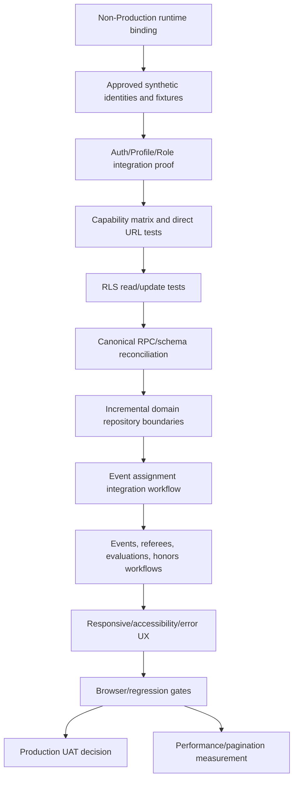

# Development Dependency Graph

## Ordering

1. Keep runtime bound to Non-Production and provision approved fixture capability.
2. Validate Auth/Profile/Role and RLS identity boundaries.
3. Reconcile canonical contracts before introducing abstractions around broken calls.
4. Validate `event_assignments` end-to-end, including audit/notification/cache behavior.
5. Extract repositories incrementally from highest-risk domains, not as a rewrite.
6. Add browser/accessibility/error-state gates.
7. Only then optimize scale and build advanced features.
