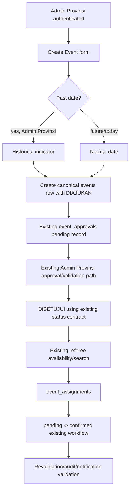

# Phase 8.5 Event Workflow

## Implemented in this phase

Only the date-picker rule and Historical Event indicator. Existing status, approval, assignment, step-up, and RLS boundaries were reused; no new status, RPC, table, or field was created.

## Unverified

Remote authorization, RLS, duplicate prevention, audit, notification, and post-mutation persistence require approved Non-Production fixtures.
